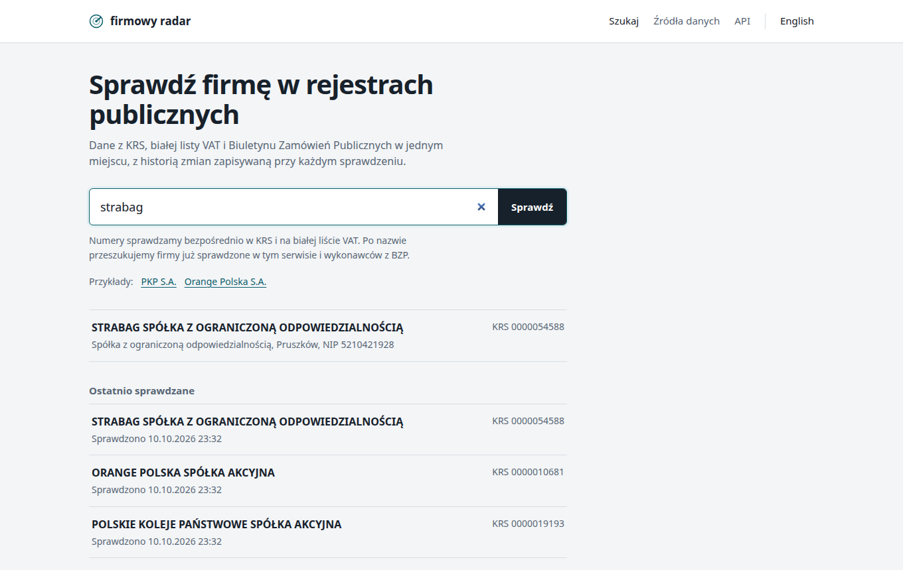
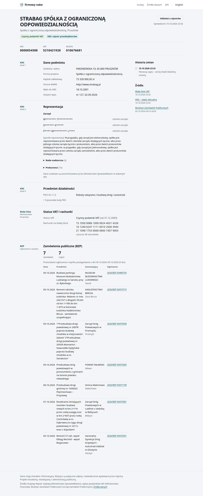
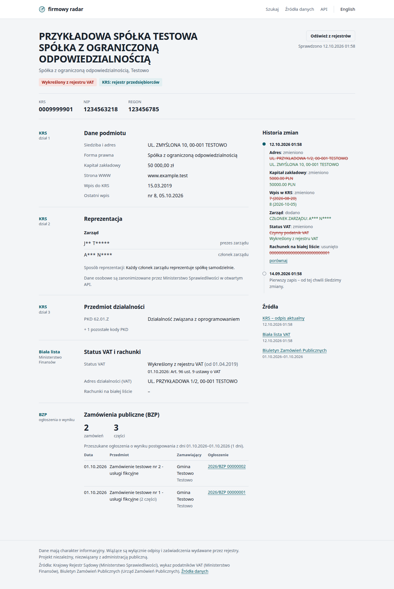
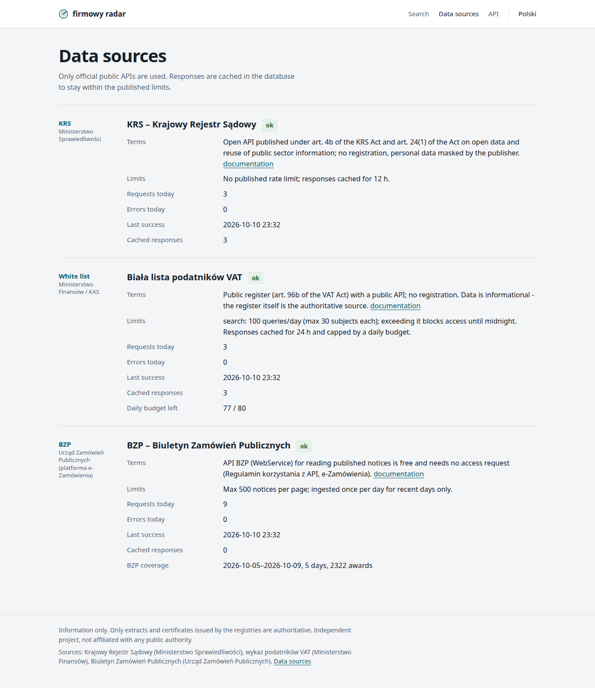
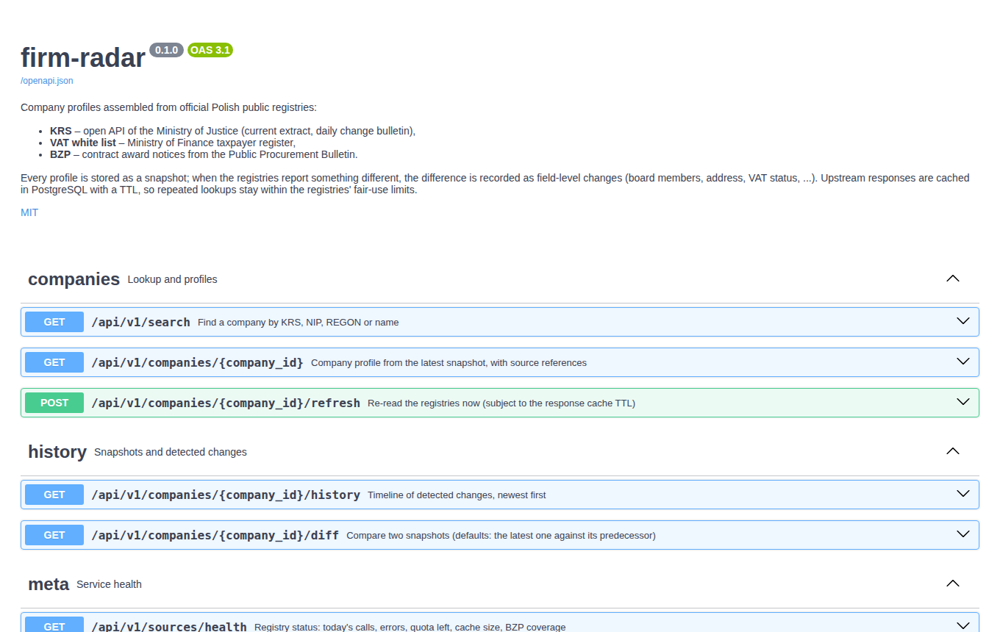
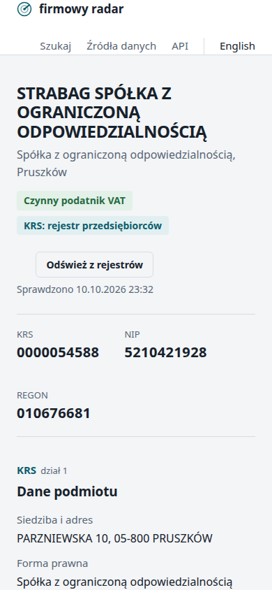
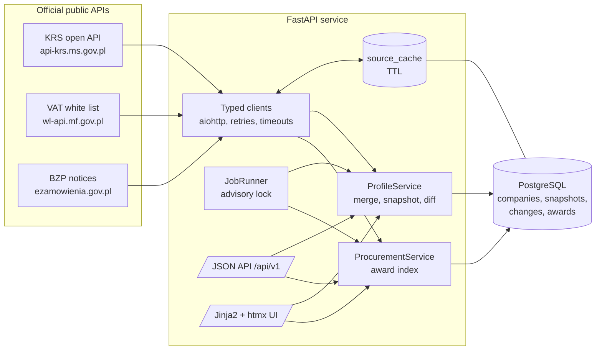

# firmowy radar (`firm-radar`)

[](https://github.com/MaciejZiel/firm-radar/actions/workflows/ci.yml)


[](LICENSE)

Type a KRS, NIP or REGON number and get one profile of a Polish company, built only from
**official public registries**: the court register (KRS), the VAT taxpayer "white list" and
public procurement awards from the Public Procurement Bulletin (BZP). Every check is stored
as a snapshot, so the service also shows **what changed and when**: a new board member, a
moved seat, a raised share capital, a VAT registration that was removed.

It is an API first (FastAPI, OpenAPI docs with examples) with a small server-rendered UI in
Polish, with an English toggle.



## What it does

- **One lookup, three registries.** A NIP or REGON goes to the white list, which returns the
  KRS number; the KRS number gets the current court extract. Both are merged into one
  normalized model (`CompanyData`) with the source of every block kept.
- **Change history.** A new snapshot is written only when the merged content changes; each
  one stores field-level changes (`added` / `removed` / `modified`). List fields such as the
  board are compared as sets, so one new member is one change.
- **Public procurement.** Contract award notices from BZP are ingested day by day and indexed by
  contractor NIP; a profile shows the awards together with the period that was searched.
- **Background refresh.** Tracked companies listed in the KRS daily change bulletin are
  re-read (cache bypassed); stale profiles are refreshed; recent BZP days are ingested.
- **Fair use of the registries.** Responses are cached in PostgreSQL with a TTL, retries are
  bounded, and the white list (100 queries/day) is guarded by a daily budget.

| Company profile (real data, KRS + white list + BZP) | Change timeline (fictional test data) |
|---|---|
|  |  |

| Data sources and health (English UI) | API docs | Mobile layout |
|---|---|---|
|  |  |  |

The timeline screenshot uses the fictional fixtures from `tests/fixtures` (a company that
does not exist) because a real company needs days or weeks to change. All other screenshots
show live data from the official APIs; board members' names are masked by the Ministry of
Justice at source.

## Architecture



```
src/firm_radar/
├── sources/      base.py (fetcher, errors), store.py (PG cache + counters),
│                 krs.py, whitelist.py, bzp.py, catalog.py (terms and limits)
├── services/     profiles.py (resolve, merge, snapshots), diff.py, procurement.py, jobs.py
├── api/          routes.py, models.py (response models + OpenAPI examples), health.py
├── web/          routes.py, i18n.py, templates/, static/
├── models.py     SQLAlchemy 2 models      migrations/ (Alembic)
└── cli.py        firm-radar jobs | ingest-bzp | lookup
```

## Data sources and their terms

Only official, documented, public interfaces are used. No website is scraped.

| Source | What we read | Access | Limits and how they are respected | Terms / legal basis |
|---|---|---|---|---|
| **KRS** (Ministerstwo Sprawiedliwości) | Current extract (`OdpisAktualny`), daily change bulletin (`Biuletyn`) | Public, no key | No published limit; 12 h cache, bulletin used to refresh only what changed | [Otwarte API KRS](https://prs.ms.gov.pl/krs/openApi): art. 4b of the KRS Act with art. 24(1) of the Act on open data and reuse of public sector information. Personal data is masked by the publisher. |
| **Biała lista VAT** (Ministerstwo Finansów / KAS) | `search/nip`, `search/regon` | Public, no key | `search`: 100 queries/day (max 30 subjects); exceeding it blocks access until midnight. 24 h cache and a configurable daily budget (default 80). | [API wykazu podatników VAT](https://www.gov.pl/web/kas/api-wykazu-podatnikow-vat); public register under art. 96b of the VAT Act. |
| **BZP** (Urząd Zamówień Publicznych, e-Zamówienia) | Contract award notices (`TenderResultNotice`) | Public, no key, no access request | Max 500 notices per page; ingested once per day for complete days only | [Regulamin korzystania z API](https://ezamowienia.gov.pl/pl/regulamin/) (API BZP WebService: free, no access request needed for reading notices). |

Attribution: data from Krajowy Rejestr Sądowy (Ministerstwo Sprawiedliwości), wykaz podatników
VAT (Ministerstwo Finansów) and Biuletyn Zamówień Publicznych (Urząd Zamówień Publicznych).
The project is independent and not affiliated with any public authority.

## API

Interactive docs at `/docs` (OpenAPI at `/openapi.json`).

| Method | Path | Purpose |
|---|---|---|
| `GET` | `/api/v1/search?q=` | KRS / NIP / REGON (checksum-validated, `krs:`/`nip:`/`regon:` prefix forces the type) or part of a name |
| `GET` | `/api/v1/companies/{id}` | Profile from the latest snapshot, procurement summary, source references |
| `POST` | `/api/v1/companies/{id}/refresh` | Re-read the registries (within cache TTL) |
| `GET` | `/api/v1/companies/{id}/history` | Snapshots with their changes, newest first |
| `GET` | `/api/v1/companies/{id}/diff?from=&to=` | Compare any two snapshots |
| `GET` | `/api/v1/sources/health` | Status, calls and errors today, white list budget left, cache size, BZP coverage |

```bash
curl -s "localhost:8093/api/v1/search?q=0000019193" | jq '.results[0]'
curl -s "localhost:8093/api/v1/companies/1/history" | jq '.timeline[0].changes'
```

## Quick start

Docker Compose (project `firm-radar-demo`, app on **http://localhost:8093**, PostgreSQL on
host port **55433**):

```bash
docker compose up --build
# migrations run on start; open http://localhost:8093
docker compose down -v   # stop and remove the demo database
```

Local development with [uv](https://docs.astral.sh/uv/):

```bash
docker compose up -d db
uv sync
uv run alembic upgrade head
uv run uvicorn firm_radar.main:create_app --factory --reload --port 8000
uv run firm-radar ingest-bzp --days 7     # fill the procurement index
uv run firm-radar lookup 5260250995       # resolve one company from the CLI
```

Configuration is read from `FIRM_RADAR_*` environment variables (see
[`config.py`](src/firm_radar/config.py)): database URL, cache TTLs, white list budget,
refresh interval, number of BZP days to ingest, `FIRM_RADAR_SCHEDULER_ENABLED`.

## Tests and quality

```bash
docker compose up -d db
docker compose exec db psql -U firm_radar -c "create database firm_radar_test"
uv run pytest            # 78 tests
uv run ruff check . && uv run ruff format --check . && uv run mypy
```

- Upstream HTTP is replayed from recorded-response fixtures with
  [aioresponses](https://github.com/pnuckowski/aioresponses); any request without a
  registered response fails, so tests never reach the network. The fixtures keep the exact
  structure of real responses, but every value in them is fictional.
- Service, job and API tests run against a real PostgreSQL (upserts, advisory locks and JSONB
  behave as in production). The API and UI are exercised in-process through a small ASGI
  client in `tests/asgi.py`.
- CI (GitHub Actions): ruff, mypy (strict), Alembic upgrade + downgrade, pytest with a
  PostgreSQL service, Docker image build.

## Key design decisions

- **Snapshots on change, not on every check.** A SHA-256 of the canonical JSON decides whether
  anything changed; `last_checked_at` is updated either way. History stays small and every
  stored snapshot means something.
- **An outage is not a change.** When one registry fails, its section is carried over from the
  previous snapshot and the failure is shown in the source list. Otherwise a short white list
  outage would be recorded as "VAT status removed" and then "added" again.
- **Cache in PostgreSQL, not in memory.** The quotas are per day and per client, so the cache
  and the request counters have to survive restarts and be shared between instances.
- **Bulletin-driven refresh.** The KRS daily bulletin lists entities with a new entry; only
  those tracked companies are re-read with the cache bypassed, everything else waits for its
  TTL.
- **Local award index.** The BZP API cannot filter by contractor, so award notices are
  ingested per day and indexed by NIP. The profile always states which days were searched.
- **Dependencies with permissive licenses only.** httpx was replaced by aiohttp because httpx
  requires `certifi` (MPL-2.0); mypy is pinned to 1.15, the last release without the MPL-2.0
  `pathspec` dependency; PostgreSQL is reached through asyncpg (Apache-2.0) instead of the
  LGPL psycopg. Every component is listed in [`3rdparty_licenses.md`](3rdparty_licenses.md).

## Limitations

- **Information only.** Registry APIs are not certified extracts; only documents issued by the
  registries are legally binding. Data can lag behind the registers.
- **Name search is limited.** None of the registries offers search by name through these
  APIs, so names only match companies already looked up here and BZP contractors.
- **Sole proprietorships** are not in KRS; for them only the white list (and BZP) is available.
  White list entries of natural persons may contain personal data; keep that in mind before
  running a public instance (GDPR).
- **Masked people.** The open KRS API masks names of board members, so a change of a person
  is visible only as a change of the masked label.
- **BZP coverage** is limited to the days ingested (default: the last 3 complete days, more
  via `firm-radar ingest-bzp --days N`) and to national notices; EU-threshold notices
  published only in TED are not included. Contractors without a valid Polish NIP are skipped.
- **White list quota.** With the default budget the instance can make about 80 new white list
  lookups per day; further lookups use the cache or are reported as unavailable.
- The in-process scheduler suits a single instance; several instances are safe (advisory lock)
  but only one does the work.

## Changelog

See [`CHANGELOG.md`](CHANGELOG.md).

## License

[MIT](LICENSE) © 2026 Maciej Zieliński. Third-party components and their licenses:
[`3rdparty_licenses.md`](3rdparty_licenses.md).
